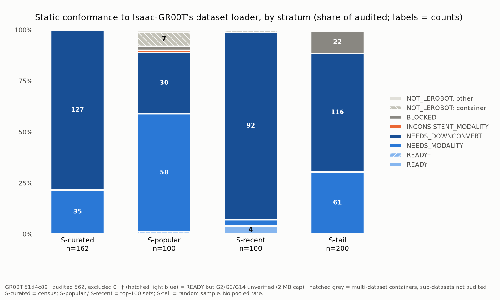

# lerobot-groot-conformance

**How much public robot data can be loaded by NVIDIA Isaac GR00T today, and what's in the way for the rest?**

People generally assume that robot learning data is fragmented across formats, but the gap is
rarely measured. This project measures it against one concrete, open target: the dataset loader
in NVIDIA's [Isaac-GR00T](https://github.com/NVIDIA/Isaac-GR00T) reference implementation. The
sample is **562 public Hugging Face datasets tagged `LeRobot`**. GR00T's format is LeRobot v2 plus
one extra file (`meta/modality.json`), so this is a favourable case. Whatever separates the two is
fragmentation that remains even between closely related formats. The project has three parts:
- a metadata-only linter, with every check cited to GR00T's source;
- a stratified audit;
- a [draft producer checklist](CHECKLIST.md) derived from both.

GR00T pinned at [`51d4c89`](https://github.com/NVIDIA/Isaac-GR00T/tree/51d4c89f72fda44cbf77285c6a8114b52676b8a1)
(`main` as of 2026-10-01). Audit run 2026-09-29. Cost: no GPU, metadata only.

## Headline

**In the random sample of the long tail (n = 200), 30.5% of datasets pass every blocking static
check apart from the missing `modality.json` (95% CI 24.5–37.2%). None pass all of them.**
The most common blocker after `modality.json` is the **LeRobot v3.0 file layout** (58%,
CI 51–65%). GR00T reads v2.x, ships a converter, and documents plans for native v3 support.

The sample has four strata, drawn in different ways (see [Method](#method-and-limitations)), so
**every number is per stratum. There is no pooled rate.**



| verdict | meaning | curated (n=162) | popular (n=100) | recent (n=100) | tail (n=200) |
|---|---|---|---|---|---|
| `READY` | passes all static checks | 0 | 1† | 4 | 0 |
| `NEEDS_MODALITY` | passes everything except: no `meta/modality.json` | 35 (22%) | 58 (58%) | 3 (3%) | 61 (30%) |
| `NEEDS_DOWNCONVERT` | v3.0 layout → `convert_v3_to_v2.py`, then add `modality.json` | 127 (78%) | 30 (30%) | 92 (92%) | 116 (58%) |
| `INCONSISTENT_MODALITY` | ships `modality.json`, but it disagrees with the data | 0 | 1 | 0 | 0 |
| `BLOCKED` | no episode data uploaded, or another structural failure with no tool | 0 | 2 | 0 | 22 (11%) |
| `NOT_LEROBOT` | multi-dataset container, or a different format | 0 | 8 | 1 | 1 |

† its `episodes.jsonl` exceeded the 2 MB metadata cap, so two checks could not run.
3 popular datasets also have episode files that are listed but absent (fixable, lossily, by
NVIDIA's repair script). They are counted in their primary row.

**Missing `modality.json` is not a dataset defect.** It is the one GR00T-specific file, and standard
LeRobot doesn't define it. It is absent in **96–100%** of LeRobot-format datasets in every
stratum. That is the gap between the open LeRobot format and GR00T's training format, which a
canonical standard would close. Writing the file needs someone who knows which state dimension
is which joint, so it is the only step with no tool.

### What fails besides `modality.json`

Denominator: LeRobot-format datasets. Causes are not exclusive. Full tables, including every
individual check, are in [`results/report.md` §2](results/report.md#2-what-fails-besides-the-missing-modalityjson).

| root cause | level | who fixes it | curated (n=162) | popular (n=92) | recent (n=99) | tail (n=199) |
|---|---|---|---|---|---|---|
| **none: passes every blocking check except `modality.json`** | | | **35 (22%)** | **56 (61%)** | **7 (7%)** | **61 (31%)** |
| v3.0 layout (GR00T reads v2.x) | blocking | converter: NVIDIA's `convert_v3_to_v2.py` | 127 (78%) | 30 (33%) | 92 (93%) | 116 (58%) |
| no episode data: `info.json` but no parquet (mostly 0-byte `eval_*` repos) | blocking | producer: upload the data | 0 | 1 (1%) | 0 | 22 (11%) |
| episode files listed but absent | blocking | NVIDIA's repair script (drops episodes) | 0 | 3 (3%) | 0 | 0 |
| `modality.json` shipped but a state dim is in no group | blocking, **silent** | producer | 0 | 1 (1%) | 0 | 0 |
| other structural failure on a v2.x layout | blocking | unknown | 0 | 1 (1%) | 0 | 0 |
| no `meta/stats.json` | warning | automatic: GR00T regenerates stats at train time | 24 (15%) | 49 (53%) | 7 (7%) | 82 (41%) |
| no `names` on state/action dims | info | producer | 10 (6%) | 17 (18%) | 1 (1%) | 14 (7%) |
| missing `dtype`, non-float state/action, missing `fps`, `total_episodes` mismatch | various | — | 0 | 1 (1%) | 0 | 0 |

Three things stand out.
- **The curated layer is v3.0.** All 124 `lerobot/*` datasets use the v3.0 layout, which current
  LeRobot writes by default. GR00T's docs describe v2 as the supported format today and plan native
  v3 support ([data_preparation.md L15](https://github.com/NVIDIA/Isaac-GR00T/blob/51d4c89f72fda44cbf77285c6a8114b52676b8a1/getting_started/data_preparation.md?plain=1#L15)).
  Until then, the newest data is the furthest from loadable: 92% of the most recently updated sample.
- **About 11% of the random tail is metadata without data**, mostly evaluation runs. No converter
  can fix that.
- **The most-downloaded layer is the closest.** 58 of 100 popular datasets are `NEEDS_MODALITY`,
  one file away. However, 32 of the 100 come from a single producer (RoboCOIN). Without them it is
  26 of 68, or 38% ([sensitivity table](results/report.md#sensitivity-producer-concentration)).

## How to run

Python 3.11. The linter itself is stdlib-only. The audit and report need `requirements.txt`.

```bash
python3.11 -m venv .venv && .venv/bin/pip install -r requirements.txt
```

**One dataset**, from the Hub (metadata only, about 8 requests) or from a local directory:

```bash
.venv/bin/python -m conformance.inspect_hub youliangtan/tictac-bot
```

```bash
.venv/bin/python -m conformance.inspect_local path/to/dataset
```

**The full audit.** This rebuilds the sample from the committed enumeration snapshot and checks
that it is byte-identical. It then regenerates `results/summary.csv`, `results/report.md` and the
chart from the committed per-dataset results. It takes seconds and needs no network:

```bash
.venv/bin/python scripts/reproduce.py
```

Add `--reaudit` to re-fetch metadata for all 562 repos at their current commits, into
`results_reaudit/`. This takes about 30 minutes; set `HF_TOKEN` first.

**Tests.** The gate checks that a known-good public dataset comes out `NEEDS_MODALITY`, a
deliberately corrupted copy comes out `BLOCKED`, and NVIDIA's own `cube_to_bowl_5` demo comes out
`READY`, plus 17 other controls:

```bash
.venv/bin/python -m unittest discover -s tests -t . -v
```

## The practical takeaway: [CHECKLIST.md](CHECKLIST.md)

**Draft producer checklist for GR00T-readiness (v0.1).** This is not a standard; it is a checklist
you could hand to a data producer before they start recording. It has three tiers:
- **Required:** each item cited to a line of GR00T's code or docs.
- **Observed:** each item with its count from this audit.
- **Open questions:** for example, which action space to record, given that GR00T N1.7 uses relative
  end-effector actions and most public data is absolute joint positions.

Items are split into **producer-side** (must be captured while recording) and **converter-side**
(a script can fix them later).

## Method and limitations

**What the checks cover.** There are 28 checks ([`conformance/checks.py`](conformance/checks.py)):
- `L1`–`L12`: LeRobot validity and consistency.
- `G1`–`G16`: the GR00T contract. Each G-check carries a citation generated from
  [`vendor/groot_51d4c89/`](vendor/groot_51d4c89/), the exact GR00T files the contract is read from.

[`CONTRACT.md`](CONTRACT.md) documents each clause: what raises, what GR00T repairs itself, and
what fails silently. Every check runs, with no short-circuiting. A check whose input is missing
is reported as *skipped*, never as a second failure.

**How the sample was drawn** (full detail in [`NOTES.md`](NOTES.md), Phase 2). Every dataset with
the `LeRobot` tag was enumerated on 2026-09-29: 78,296 ids, snapshot in
`results/dataset_list.json.gz`. These were split into four disjoint strata:

| stratum | rule | n | what it represents |
|---|---|---|---|
| curated | census of `lerobot`, `nvidia`, `IPEC-COMMUNITY`, `HuggingFaceVLA`, `physical-intelligence` | 162 | institutional publishers |
| popular | top 100 by 30-day downloads, non-gated | 100 | what people actually pull |
| recent | top 100 by last-modified | 100 | current tooling defaults; an ~18-hour window |
| tail | **seeded random sample** (seed 20260928) of everything else | 200 | the long tail; **the only stratum with confidence intervals** |

Gated repos were not sampled. 36 were skipped in popular, all from one org. Fetch failures went to
a separate bucket outside the denominator. The final count was **0** after retries.

**Limitations.**
- **Static metadata checks only.** No dataset was loaded with GR00T's loader, and no parquet or
  video content was read. A file over 2 MB was never downloaded. `READY` means *passes all static
  checks*, not *trains correctly*. Validating the linter by actually loading the passing datasets
  through GR00T is the obvious next step. It was not done here because it needs GR00T's full
  install and payload downloads.
- **One loading path.** GR00T N1.7 can also be fine-tuned through LeRobot's own `groot` policy,
  which reads LeRobot datasets with LeRobot's loader. That path is not measured here. This audit
  covers the Isaac-GR00T reference implementation's data path, as its README and
  `getting_started/data_preparation.md` describe it.
- **Not checkable from metadata:**
  - whether group names match a particular training recipe's embodiment config;
  - camera order;
  - annotation values;
  - video frame counts ([`CONTRACT.md` §8](CONTRACT.md)).
- **Sample construction.** Popular and recent are purposive top-100 sets, not samples. Recent covers
  about 18 hours, and 15 of its 100 datasets come from one author. Repos are the audit unit:
  8 multi-dataset containers count as one row each, and their 50+ sub-datasets were not audited.
  24 datasets (6 curated, 18 popular) had a metadata file or file listing over the 2 MB cap.
  Some blocking checks could not run on them, so their verdicts are lower bounds on distance.
- **LeRobot versions.** The version is detected from the layout, not trusted from
  `codebase_version`. GR00T never reads that field, and one `v3.0` string covers 8 distinct
  metadata layouts in this sample. v2.0, v2.1 and v2.2 are treated alike, as GR00T treats them.
- **Changes on 2026-10-01**, after the original run (see [`NOTES.md`](NOTES.md)):
  - Verdicts renamed to this README's terms.
  - Four checks added (`L11`, `L12`, `G15`, `G16`), computed from `info.json` at each dataset's
    audited commit.
  - Repos with no episode data reclassified from `NEEDS_DOWNCONVERT` to `BLOCKED`
    (21 repos; tail `NEEDS_DOWNCONVERT` went from 68% to 58%).
- **The target moves.** Every number is tied to GR00T `51d4c89`. Re-pinning means re-vendoring and
  re-running ([`CONTRACT.md` §10](CONTRACT.md)).

## Layout

```
conformance/   checks.py (L1-L12, G1-G16, verdict) · contract.py (generated citations)
               inspect_local.py · inspect_hub.py (metadata-only Hub view) · report.py
scripts/       reproduce.py · collect_dataset_list.py · build_strata.py · run_audit.py · backfill_2026_10_01.py
vendor/        groot_51d4c89/: the GR00T files the contract is read from (Apache-2.0, unmodified)
fixtures/      control datasets for the tests (meta files real; payload files are empty placeholders)
results/       raw/<repo>.json per dataset · summary.csv · report.md · conformance_chart.png · strata.json
```

Code is MIT ([LICENSE](LICENSE)). `vendor/` and `fixtures/` contain third-party Apache-2.0
material; see the notices in those folders. This is an independent project, not affiliated with
NVIDIA or Hugging Face.
