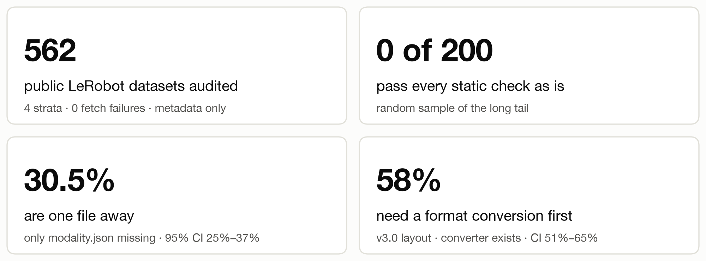
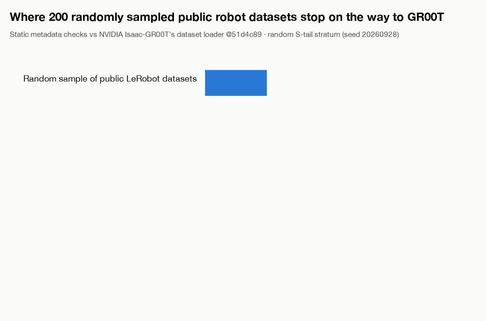
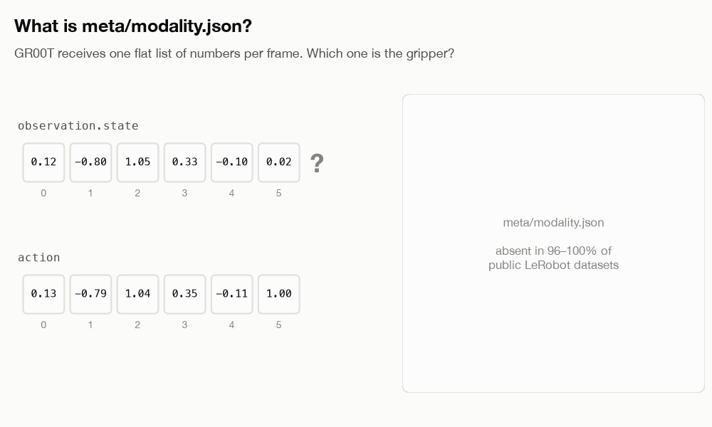
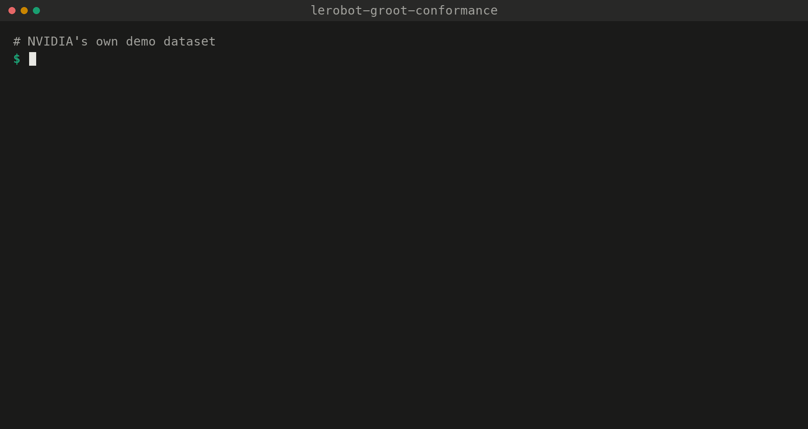

# lerobot-groot-conformance

### How much public robot data can NVIDIA Isaac GR00T load today, and what's in the way for the rest?

An audit of **562 public Hugging Face robot datasets** against the dataset loader in NVIDIA's
[Isaac-GR00T](https://github.com/NVIDIA/Isaac-GR00T) reference implementation, plus the open-source
linter that ran it and a [draft checklist](CHECKLIST.md) for people who record robot data.



> **Try it in your browser: [Robot Data Smog Check](https://vincentstanfordlead.github.io/lerobot-groot-conformance/).**
> Paste a Hugging Face dataset link and see in seconds what matches GR00T, what's missing, how to
> fix it, and whether it's the kind of robot data GR00T trains on. Where the dimension names allow,
> it also drafts the missing `modality.json`. It reads metadata only, runs entirely in your browser,
> and needs no sign-in.

## Why this matters

Robot foundation models such as GR00T are pretrained once and then **adapted to each new robot
by fine-tuning on that robot's demonstrations**. Every such dataset has to be in the model's
format. Public data could make that cheap: there are more than 78,000 datasets tagged `LeRobot`
on Hugging Face. That only works if the data can be loaded without someone hand-fixing each
dataset.

People generally assume robot data is fragmented across formats, but the gap is rarely measured.
This project measures it for a favourable case. GR00T's format is LeRobot v2 plus one extra
file, so whatever separates the two is fragmentation that remains even between closely related
formats.

## Results



In a random sample of 200 public datasets:
- **None pass every check as is.**
- **30.5% are one small file away.** The data is in the layout GR00T reads; only `meta/modality.json` is missing.
  Two of those 61 are race-car driving data, which is well-formed but not what GR00T is built for (see below).
- **58% use the newer LeRobot v3.0 layout.** GR00T reads v2 today, ships a converter, and its docs
  say native v3 support is planned
  ([data_preparation.md L15](https://github.com/NVIDIA/Isaac-GR00T/blob/51d4c89f72fda44cbf77285c6a8114b52676b8a1/getting_started/data_preparation.md?plain=1#L15)).
- **11% are metadata without data:** an `info.json` was uploaded but no episodes, mostly evaluation
  runs. No converter can fix that.

### The one missing file



`meta/modality.json` is the one file GR00T needs that standard LeRobot doesn't define, so its
absence is **a gap between two formats, not a defect in the data**. It is missing from 96–100% of
datasets in every part of the sample. Writing it takes about ten lines; getting it right takes
someone who knows which number is which joint. A shared standard would close exactly this gap.

That knowledge often already sits in the data. 84% of the random sample name their dimensions
clearly (`shoulder_pan.pos`, `gripper.pos`), so a script could draft the file. The curated
publisher datasets are the exception: 57% of them use `motor_0`…`motor_5` names that only the
original team can decode.

### Format is not the same as fit

A dataset can pass every format check and still not be GR00T training data. Some public "LeRobot"
datasets aren't robot manipulation at all. One example is a car-driving dataset (`robot_type: "KIA Niro EV 2023"`,
with steering, brake and gear as actions). Others are race-car simulations and human motion capture. A metadata
heuristic (`conformance/embodiment.py`: `robot_type` first, then feature names) classifies each dataset:

| what the data is | curated (n=162) | popular (n=92) | recent (n=99) | tail (n=199) |
|---|---|---|---|---|
| arm, bimanual, humanoid or mobile manipulator: **fits GR00T** | 130 (80%) | 89 (97%) | 98 (99%) | 193 (97%) |
| vehicle / driving, or human motion: **likely outside GR00T's scope** | 1 | 2 | 0 | 2 |
| couldn't tell from metadata | 31 (19%) | 1 | 1 | 4 |

The scale of the out-of-scope group is small: 5 of 552. Three of them pass every format check except
`modality.json`, which a format-only check would report as "one file away". The curated "couldn't
tell" row is the bigger finding: 75 of the 162 curated datasets have `robot_type: "unknown"` (mostly
older Open-X ports), so neither tools nor people can tell what robot recorded them without reading the
paper.

### Across the whole sample

The 562 datasets come from four groups, drawn in different ways, so **each group is reported on
its own and never pooled**:


- **Curated** (official publishers such as `lerobot/*`): 78% v3.0, including all 124 `lerobot/*`
  datasets, because current LeRobot writes v3.0 by default. **The best-maintained data has moved
  furthest from what GR00T reads today.**
- **Popular** (the most-downloaded): the closest, with 58 of 100 one file away. One producer
  accounts for 32 of those 100, though.
- **Recent** (newly updated): 92% v3.0, the clearest signal of where the format is heading.
- **Tail** (a random sample of everything else): the only group with confidence intervals.

<details>
<summary><b>Full results tables</b></summary>

| verdict | meaning | curated (n=162) | popular (n=100) | recent (n=100) | tail (n=200) |
|---|---|---|---|---|---|
| `READY` | passes all static checks | 0 | 1† | 4 | 0 |
| `NEEDS_MODALITY` | passes everything except: no `meta/modality.json` | 35 (22%) | 58 (58%) | 3 (3%) | 61 (30%) |
| `NEEDS_DOWNCONVERT` | v3.0 layout → `convert_v3_to_v2.py`, then add `modality.json` | 127 (78%) | 30 (30%) | 92 (92%) | 116 (58%) |
| `INCONSISTENT_MODALITY` | ships `modality.json`, but it disagrees with the data | 0 | 1 | 0 | 0 |
| `BLOCKED` | no episode data uploaded, or another structural failure with no tool | 0 | 2 | 0 | 22 (11%) |
| `NOT_LEROBOT` | multi-dataset container, or a different format | 0 | 8 | 1 | 1 |

† its metadata exceeded the 2 MB cap, so two checks could not run. 3 popular datasets also
have episode files that are listed but absent; NVIDIA's repair script can fix them by dropping
those episodes.

**What fails besides `modality.json`.** Denominator: LeRobot-format datasets. Causes can overlap.

| root cause | level | who fixes it | curated (n=162) | popular (n=92) | recent (n=99) | tail (n=199) |
|---|---|---|---|---|---|---|
| **none: passes every blocking check except `modality.json`** | | | **35 (22%)** | **56 (61%)** | **7 (7%)** | **61 (31%)** |
| v3.0 layout (GR00T reads v2.x) | blocking | converter: NVIDIA's `convert_v3_to_v2.py` | 127 (78%) | 30 (33%) | 92 (93%) | 116 (58%) |
| no episode data: `info.json` but no parquet | blocking | producer: upload the data | 0 | 1 (1%) | 0 | 22 (11%) |
| episode files listed but absent | blocking | NVIDIA's repair script (drops episodes) | 0 | 3 (3%) | 0 | 0 |
| `modality.json` shipped but a state dim is in no group | blocking, **silent** | producer | 0 | 1 (1%) | 0 | 0 |
| other structural failure on a v2.x layout | blocking | unknown | 0 | 1 (1%) | 0 | 0 |
| no `meta/stats.json` | warning | automatic: GR00T regenerates stats at train time | 24 (15%) | 49 (53%) | 7 (7%) | 82 (41%) |
| no `names` on state/action dims | info | producer | 10 (6%) | 17 (18%) | 1 (1%) | 14 (7%) |
| missing `dtype`, non-float state/action, missing `fps`, `total_episodes` mismatch | various | — | 0 | 1 (1%) | 0 | 0 |

Every table, including per-check failures, the `codebase_version` breakdown and fix-cost estimates,
is in [`results/report.md`](results/report.md). Per-dataset results are in
[`results/summary.csv`](results/summary.csv).

</details>

## Try it on any dataset



The linter reads metadata only, so it downloads no video or episode data. Each check cites the
line of GR00T code that requires it. The same 28 checks run in the
[Robot Data Smog Check web app](https://vincentstanfordlead.github.io/lerobot-groot-conformance/) (`docs/`,
plain JavaScript, no build step). `tests/test_js_parity.py` keeps the browser version and the Python
version in agreement on every test fixture and on all 545 audited `info.json` files.

```bash
python3.11 -m venv .venv && .venv/bin/pip install -r requirements.txt
```

```bash
.venv/bin/python -m conformance.inspect_hub <hf-user>/<dataset> --brief
```

Use `conformance.inspect_local <path>` for a dataset on disk. Drop `--brief` to see all 28
checks, or add `--json` for machine-readable output.

**Reproduce the whole audit** in seconds and offline, from the committed snapshot and results.
Add `--reaudit` to re-fetch all 562 repos (about 30 minutes; set `HF_TOKEN` first):

```bash
.venv/bin/python scripts/reproduce.py
```

**Tests:**
- a known-good public dataset must come out `NEEDS_MODALITY`;
- a deliberately corrupted copy must come out `BLOCKED`;
- NVIDIA's own demo must come out `READY`;
- 17 other controls must pass.

```bash
.venv/bin/python -m unittest discover -s tests -t . -v
```

## The takeaway for data producers: [CHECKLIST.md](CHECKLIST.md)

A **draft producer checklist for GR00T-readiness (v0.1)**, written to hand to someone *before*
they start recording. It is not a standard. It has three separate tiers:

| tier | what's in it | example |
|---|---|---|
| **1. Required** | each item cited to a line of GR00T's code or docs | record the true `fps`: GR00T silently assumes 30 if it's missing |
| **2. Observed** | each item with its count from this audit | upload the episodes, not just the metadata (22 of 199) |
| **3. Open questions** | what needs model-side evidence; not answered here | which action space to record: GR00T N1.7 uses relative end-effector actions, while most public data is absolute joint positions |

Items are split into **producer-side** and **converter-side**. Producer-side items must be
captured while recording because they can't be recovered later. Converter-side items can be
fixed afterwards by a script.

## Method and limitations

<details>
<summary><b>What the checks cover</b></summary>

There are 28 checks ([`conformance/checks.py`](conformance/checks.py)):
- `L1`–`L12`: LeRobot validity and consistency.
- `G1`–`G16`: the GR00T contract. Each G-check carries a citation generated from
  [`vendor/groot_51d4c89/`](vendor/groot_51d4c89/), the exact GR00T files the contract is read from.

[`CONTRACT.md`](CONTRACT.md) documents each clause: what raises an error, what GR00T repairs on
its own, and what fails silently. Every check runs, with no short-circuiting. A check whose input
is missing is reported as *skipped*, never as a second failure.

The pin is GR00T [`51d4c89`](https://github.com/NVIDIA/Isaac-GR00T/tree/51d4c89f72fda44cbf77285c6a8114b52676b8a1),
still `main` on 2026-10-01.
</details>

<details>
<summary><b>How the sample was drawn</b></summary>

Every dataset with the `LeRobot` tag was enumerated on 2026-09-29: 78,296 ids, snapshot in
`results/dataset_list.json.gz`. These were split into four disjoint strata:

| stratum | rule | n | what it represents |
|---|---|---|---|
| curated | census of `lerobot`, `nvidia`, `IPEC-COMMUNITY`, `HuggingFaceVLA`, `physical-intelligence` | 162 | institutional publishers |
| popular | top 100 by 30-day downloads, non-gated | 100 | what people actually pull |
| recent | top 100 by last-modified | 100 | current tooling defaults; an ~18-hour window |
| tail | **seeded random sample** (seed 20260928) of everything else | 200 | the long tail; **the only stratum with confidence intervals** |

Gated repos were not sampled; 36 were skipped in popular, all from one org. Fetch failures went to
a separate bucket outside the denominator; the final count was **0** after retries. Full detail is
in [`NOTES.md`](NOTES.md), Phase 2.
</details>

<details>
<summary><b>Limitations</b></summary>

- **Static metadata checks only.** No dataset was loaded with GR00T's loader, and no parquet or
  video content was read. A file over 2 MB was never downloaded. `READY` means *passes all static
  checks*, not *trains correctly*. Validating the linter by actually loading the passing datasets
  through GR00T is the obvious next step. It was not done here because it needs GR00T's full
  install and payload downloads.
- **One loading path.** GR00T N1.7 can also be fine-tuned through LeRobot's own `groot` policy,
  which reads LeRobot datasets with LeRobot's loader. That path is not measured here. This audit
  covers the Isaac-GR00T reference implementation's data path, as its README and
  `getting_started/data_preparation.md` describe it.
- **Not checkable from metadata:**
  - whether group names match a particular training recipe's embodiment config;
  - camera order;
  - annotation values;
  - video frame counts ([`CONTRACT.md` §8](CONTRACT.md)).
- **Sample construction.** Popular and recent are top-100 sets, not samples. Recent covers about
  18 hours, and 15 of its 100 datasets come from one author. 32 of the popular 100 come from one
  producer (RoboCOIN); without them, 26 of 68 (38%) are one file away. Repos are the audit unit:
  8 multi-dataset containers count as one row each, and their 50+ sub-datasets were not audited.
  24 datasets (6 curated, 18 popular) had a metadata file or file listing over the 2 MB cap. Some
  blocking checks could not run on them, so their verdicts are lower bounds on distance.
- **LeRobot versions.** The version is detected from the layout, not trusted from
  `codebase_version`. GR00T never reads that field, and one `v3.0` string covers 8 distinct
  metadata layouts in this sample. v2.0, v2.1 and v2.2 are treated alike, as GR00T treats them.
- **The "84% name their dimensions clearly" figure** comes from a keyword heuristic, hand-checked
  on about 50 datasets. Treat it as ± a few points.
- **Changes on 2026-10-01**, after the original run (see [`NOTES.md`](NOTES.md)):
  - Verdicts renamed.
  - Four checks added (`L11`, `L12`, `G15`, `G16`), computed from `info.json` at each dataset's
    audited commit.
  - Repos with no episode data reclassified from `NEEDS_DOWNCONVERT` to `BLOCKED` (21 repos; tail
    `NEEDS_DOWNCONVERT` went from 68% to 58%).
- **The target moves.** Every number is tied to GR00T `51d4c89`. Re-pinning means re-vendoring and
  re-running ([`CONTRACT.md` §10](CONTRACT.md)).
</details>

<details>
<summary><b>Repository layout</b></summary>

```
conformance/   checks.py (L1-L12, G1-G16, verdict) · contract.py (generated citations)
               inspect_local.py · inspect_hub.py (metadata-only Hub view) · report.py
scripts/       reproduce.py · make_figures.py · collect_dataset_list.py · build_strata.py · run_audit.py
               backfill_2026_10_01.py
vendor/        groot_51d4c89/: the GR00T files the contract is read from (Apache-2.0, unmodified)
fixtures/      control datasets for the tests (meta files real; payload files are empty placeholders)
results/       raw/<repo>.json per dataset · summary.csv · report.md · conformance_chart.png · strata.json
docs/          Robot Data Smog Check web app (index.html, app/*.js; served by GitHub Pages) · img/: README figures
```
</details>

Code is MIT ([LICENSE](LICENSE)). `vendor/` and `fixtures/` contain third-party Apache-2.0
material; see the notices in those folders. This is an independent project, not affiliated with
NVIDIA or Hugging Face.
