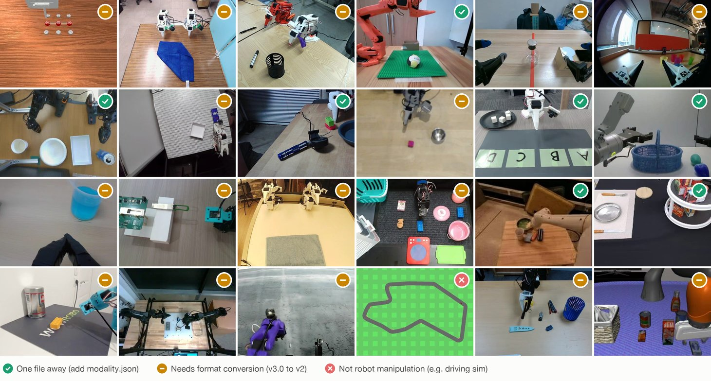
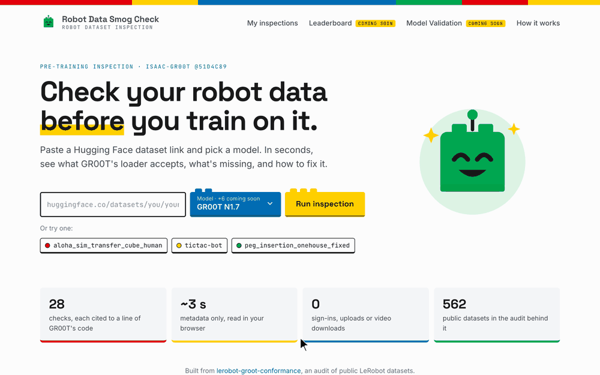

# <picture><source media="(prefers-color-scheme: dark)" srcset="docs/img/title_dark.png"></picture>

There are more than 78,000 robot datasets on Hugging Face, but no shared standard for what a robot
model needs in order to load them. This project measures that gap for one model, NVIDIA Isaac GR00T:
how much public robot data it can use today, and what stands in the way of the rest. A second pass
repeats the check for LeRobot's own loader and for openpi (π0, π0.5), to see how much of the gap is
specific to one model.

> **TL;DR**
> - **Audit:** 562 public LeRobot datasets checked against NVIDIA's
>   [Isaac-GR00T](https://github.com/NVIDIA/Isaac-GR00T) data loader. In a random sample of 200, none
>   pass as is: 30.5% are one file (`modality.json`) away, and 58% need converting from the newer
>   LeRobot v3.0 layout first. Metadata checks only; nothing was loaded through GR00T.
> - **Other loaders:** the same datasets against LeRobot's own loader and openpi. They read different
>   layouts (v3.0 only, v2.x only), so one dataset gets different answers. In the random sample, 56% load
>   in LeRobot from the Hub as is, 30% are ready for openpi's loader (which still needs a per-dataset
>   config), and 2 in 200 do both without conversion.
>   [Details below](#beyond-groot-lerobot-and-openpi).
> - **Website:** [Robot Data Smog Check](https://vincentstanfordlead.github.io/lerobot-groot-conformance/)
>   inspects any Hugging Face dataset in seconds, says what's missing and how to fix it, and drafts
>   the missing `modality.json` when the dimension names allow.
> - **Agent skill:** the same check, run by your AI agent on your own machine, for private data.
>   [Get the skill](https://vincentstanfordlead.github.io/lerobot-groot-conformance/skill/).
> - **Checklist:** a [draft checklist](CHECKLIST.md) for people who record robot data, covering what
>   to capture so the data is GR00T-ready from the start.

## Run it locally: the agent skill

[](https://vincentstanfordlead.github.io/lerobot-groot-conformance/skill/)

**[Skill page: what it does, install, download](https://vincentstanfordlead.github.io/lerobot-groot-conformance/skill/)** · or download the zip directly:
[`robot-data-smog-check.zip`](docs/download/robot-data-smog-check.zip)

**Private or vendor data?** Download the **Robot Data Smog Check** agent skill and ask Claude
*"Is this dataset ready to fine-tune GR00T and π0.5?"*. It runs the same checks as the website (GR00T,
openpi and π0.5) on your own machine. It reads only `meta/*.json(l)` and the file listing, never opens
episodes or video, and uploads nothing.

| | How to install |
|---|---|
| **Claude Code** | Unzip into `~/.claude/skills/` (you get `~/.claude/skills/robot-data-smog-check/`), then start a new session. |
| **claude.ai** | Upload the zip as a skill in Settings. |
| **No agent** | `python3 robot-data-smog-check/scripts/smog_check.py check <dataset-folder>`. Python 3.9+, nothing to install. |

You get a short report in English, the same every time, then an offer of the full details:

```
Dataset diagnostic report: tictac-bot
  Dataset  tictac-bot · LeRobot v2.1 · 50 episodes · 30 fps · 1 camera
  Robot    ✅ Single robot arm (robot_type: so100): a fit for these models
  Privacy  Read 3 metadata files (7.7 KB) on this machine. Nothing uploaded.

GR00T N1.7 · 🟡 One step away                π0.5 (openpi) · ✅ Ready to configure
  ✅ Dataset basics                             ✅ Loads in openpi
  ✅ File layout GR00T reads                    ✅ Actions & state
  ❌ modality.json: meta/modality.json missing  ✅ Cameras
  🟡 Data types & statistics (optional)         ✅ Frame rate & episode length
  ✅ Consistency                                ✅ Task prompt
  Next: add meta/modality.json (draft saved)    Next: write the openpi config (plan saved)
```

More on what it does, the modality.json draft and the delivery manifest:
[Use it as an agent skill](#use-it-as-an-agent-skill).



<sub>One frame from each of 24 audited datasets, with that dataset's real verdict. The tiles were
picked for variety, so the colour mix is illustrative; the measured split is in the scorecard below.
Frames are from Apache-2.0 datasets at the audited commit
([sources](docs/img/mosaic_frames/sources.json)).</sub>


> **Try it in your browser: [Robot Data Smog Check](https://vincentstanfordlead.github.io/lerobot-groot-conformance/).**
> Paste a Hugging Face dataset link and see in seconds what matches GR00T, what's missing, how to
> fix it, and whether it's the kind of robot data GR00T trains on. Where the dimension names allow,
> it also drafts the missing `modality.json`. It reads metadata only, runs entirely in your browser,
> and needs no sign-in.

<a href="https://vincentstanfordlead.github.io/lerobot-groot-conformance/"></a>

## Why this matters

Robot foundation models such as GR00T are pretrained once and then **adapted to each new robot
by fine-tuning on that robot's demonstrations**. Every such dataset has to be in the model's
format. Public data could make that cheap: there are more than 78,000 datasets tagged `LeRobot`
on Hugging Face. That only works if the data can be loaded without someone hand-fixing each
dataset.

People generally assume robot data is fragmented across formats, but the gap is rarely measured.
This project measures it for a favourable case. GR00T's format is LeRobot v2 plus one extra
file, so whatever separates the two is fragmentation that remains even between closely related
formats.

## Results


In a random sample of 200 public datasets:
- **None pass every check as is.**
- **30.5% are one small file away.** The data is in the layout GR00T reads; only `meta/modality.json` is missing.
  Two of those 61 are race-car driving data, which is well-formed but not what GR00T is built for (see below).
- **58% use the newer LeRobot v3.0 layout.** GR00T reads v2 today, ships a converter, and its docs
  say native v3 support is planned
  ([data_preparation.md L15](https://github.com/NVIDIA/Isaac-GR00T/blob/51d4c89f72fda44cbf77285c6a8114b52676b8a1/getting_started/data_preparation.md?plain=1#L15)).
- **11% are metadata without data:** an `info.json` was uploaded but no episodes, mostly evaluation
  runs. No converter can fix that.

### The one missing file


`meta/modality.json` is the one file GR00T needs that standard LeRobot doesn't define, so its
absence is **a gap between two formats, not a defect in the data**. It is missing from 96–100% of
datasets in every part of the sample. Writing it takes about ten lines; getting it right takes
someone who knows which number is which joint. A shared standard would close exactly this gap.

That knowledge often already sits in the data. 84% of the random sample name their dimensions
clearly (`shoulder_pan.pos`, `gripper.pos`), so a script could draft the file. The curated
publisher datasets are the exception: 57% of them use `motor_0`…`motor_5` names that only the
original team can decode.

### Format is not the same as fit

A dataset can pass every format check and still not be GR00T training data. Some public "LeRobot"
datasets aren't robot manipulation at all. One example is a car-driving dataset (`robot_type: "KIA Niro EV 2023"`,
with steering, brake and gear as actions). Others are race-car simulations and human motion capture. A metadata
heuristic (`conformance/embodiment.py`: `robot_type` first, then feature names) classifies each dataset:

| what the data is | curated (n=162) | popular (n=92) | recent (n=99) | tail (n=199) |
|---|---|---|---|---|
| arm, bimanual, humanoid or mobile manipulator: **fits GR00T** | 130 (80%) | 89 (97%) | 98 (99%) | 193 (97%) |
| vehicle / driving, or human motion: **likely outside GR00T's scope** | 1 | 2 | 0 | 2 |
| couldn't tell from metadata | 31 (19%) | 1 | 1 | 4 |

The scale of the out-of-scope group is small: 5 of 552. Three of them pass every format check except
`modality.json`, which a format-only check would report as "one file away". The curated "couldn't
tell" row is the bigger finding: 75 of the 162 curated datasets have `robot_type: "unknown"` (mostly
older Open-X ports), so neither tools nor people can tell what robot recorded them without reading the
paper.

### Across the whole sample

The 562 datasets come from four groups, drawn in different ways, so **each group is reported on
its own and never pooled**:


- **Curated** (official publishers such as `lerobot/*`): 78% v3.0, including all 124 `lerobot/*`
  datasets, because current LeRobot writes v3.0 by default. **The best-maintained data has moved
  furthest from what GR00T reads today.**
- **Popular** (the most-downloaded): the closest, with 58 of 100 one file away. One producer
  accounts for 32 of those 100, though.
- **Recent** (newly updated): 92% v3.0, the clearest signal of where the format is heading.
- **Tail** (a random sample of everything else): the only group with confidence intervals.

### Beyond GR00T: LeRobot and openpi

The same audited datasets, checked against two more loaders: LeRobot's own (used by its ACT, Diffusion
and SmolVLA policies) and openpi (π0, π0-FAST, π0.5). Metadata only; nothing was loaded through any model.
The three read different layouts, and what is left to do for a dataset in the right layout differs in
kind:

| loader | reads | what is left once the layout is right |
|---|---|---|
| GR00T | LeRobot v2 | add one data file, `meta/modality.json` |
| LeRobot | v3.0 only | nothing, if the repo has a `v3.0` version tag |
| openpi | v2.x only | write a Python data config and compute normalization stats, for every dataset |

| per stratum | curated (n=162) | popular (n=100) | recent (n=91) | tail (n=200) |
|---|---|---|---|---|
| LeRobot loads it from the Hub as is | 127 (78%) | 20 (20%) | 80 (88%) | 112 (56%) |
| openpi: layout and tags fine, config still to write | 144 (89%) | 16 (16%) | 7 (8%) | 60 (30%) |
| both, with no conversion | 110 (68%) | 2 (2%) | 0 | 2 (1%) |
| repo has no version tag at all | 1 | 57 (57%) | 3 | 6 (3%) |

In the random sample (tail), LeRobot loads 56.0% (95% Wilson CI 49.1–62.7%) and openpi is at its best
state for 30.0% (24.1–36.7%). No intervals for the other groups, which are not random samples.

- **Version tags decide loading by repo id.** Both LeRobot loaders choose the revision to download from
  the repo's version-named branches and tags, not from `info.json`. A repo with no such tag fails to load
  in LeRobot and in openpi, and the fix is one `create_tag` call. 67 of the 543 LeRobot-format repos
  whose tags were read have none, 57 of them in the most-downloaded group. GR00T reads a local copy, so it
  is unaffected.
- **Only repos that keep an older tag beside the newest one serve both loaders.** That is 110 curated
  repos, 108 of them from the official `lerobot` organisation, which keep a `v2.1` tag pointing at an
  older snapshot in the v2 layout (checked, below). Community data nearly always carries one version.
- **openpi has no "as is".** Its data config (which keys are images, state and actions) lives in Python,
  not in the dataset. Where GR00T asks for one extra file, openpi asks for a few lines of code. This is a
  design choice with a cost on both sides; a file is easier to audit and to hand to a data producer.
- **Where a loader would pull a snapshot other than the latest, that snapshot was inspected** (148 of
  them). Of 125 for openpi, 4 verdicts changed; of 23 for LeRobot, none.

#### Does the data fit π0.5?

Loading is half the question for openpi. The other half is whether what is in the files fits
**π0.5**, the openpi model people use most (`pi05_base`), as openpi ships it: actions and state at most
32 wide, three 224×224 image slots, 50-step action chunks, a text prompt. Eight checks (P1–P8) read
this from `info.json`; they do not depend on the loading verdict.

| per stratum | curated (n=162) | popular (n=92) | recent (n=90) | tail (n=199) |
|---|---|---|---|---|
| fits π0.5's defaults: the config only renames keys | 49 (30%) | 25 (27%) | 58 (64%) | 135 (68%) |
| fits with changes (cameras to choose, low frame rate, split vectors, no prompt) | 100 (62%) | 36 (39%) | 29 (32%) | 57 (29%) |
| does not fit as shipped (action or state over 32, no action, no RGB camera) | 13 (8%) | 31 (34%) | 3 (3%) | 7 (4%) |
| loads in openpi **and** fits the defaults | 42 (26%) | 4 (4%) | 3 (3%) | 42 (21%) |

In the tail sample, 67.8% fit the defaults (95% Wilson CI 61.1–73.9%) and 21.1% (16.0–27.3%) both load
and fit. The most common change in the curated group is the frame rate: 53% are recorded at 15 Hz or
less, where a 50-step chunk spans 3.3 s or more and openpi's own low-rate π0.5 configs use a shorter horizon.
In the popular group, a third carry action or state vectors wider than 32.
n here excludes repos without a readable `info.json`. Rules and code citations:
[contract §7](CONTRACT_lerobot_openpi.md#7-π05-model-fit). The web app shows the same eight checks per
dataset, plus a starting point for the openpi config (camera slots, keys, `action_horizon`).

Caveats: the columns cover the 553 of 562 audited repos that still exist (the 9 that are gone were all in
the recent group, hence n=91; the other tables above use the original n). Of those 553, 10 are not LeRobot
datasets and count as blocked without their tags being read. openpi's timestamp-sync check (every frame within 0.1 ms of its expected
time) needs the episode files and was not run, so openpi's figures are an upper bound. Tags were read on
2026-10-02, not at the audited commit. Several judgement calls are open in [`NOTES.md`](NOTES.md), among
them naming openpi's best state `NEEDS_CONFIG` rather than a pass. The rules, with code citations, are in
[`CONTRACT_lerobot_openpi.md`](CONTRACT_lerobot_openpi.md); every table is in
[`results/report_models.md`](results/report_models.md) and per-dataset results in
[`results/models.csv`](results/models.csv).

<details>
<summary><b>Full results tables</b></summary>

| verdict | meaning | curated (n=162) | popular (n=100) | recent (n=100) | tail (n=200) |
|---|---|---|---|---|---|
| `READY` | passes all static checks | 0 | 1† | 4 | 0 |
| `NEEDS_MODALITY` | passes everything except: no `meta/modality.json` | 35 (22%) | 58 (58%) | 3 (3%) | 61 (30%) |
| `NEEDS_DOWNCONVERT` | v3.0 layout → `convert_v3_to_v2.py`, then add `modality.json` | 127 (78%) | 30 (30%) | 92 (92%) | 116 (58%) |
| `INCONSISTENT_MODALITY` | ships `modality.json`, but it disagrees with the data | 0 | 1 | 0 | 0 |
| `BLOCKED` | no episode data uploaded, or another structural failure with no tool | 0 | 2 | 0 | 22 (11%) |
| `NOT_LEROBOT` | multi-dataset container, or a different format | 0 | 8 | 1 | 1 |

† its metadata exceeded the 2 MB cap, so two checks could not run. 3 popular datasets also
have episode files that are listed but absent; NVIDIA's repair script can fix them by dropping
those episodes.

**What fails besides `modality.json`.** Denominator: LeRobot-format datasets. Causes can overlap.

| root cause | level | who fixes it | curated (n=162) | popular (n=92) | recent (n=99) | tail (n=199) |
|---|---|---|---|---|---|---|
| **none: passes every blocking check except `modality.json`** | | | **35 (22%)** | **56 (61%)** | **7 (7%)** | **61 (31%)** |
| v3.0 layout (GR00T reads v2.x) | blocking | converter: NVIDIA's `convert_v3_to_v2.py` | 127 (78%) | 30 (33%) | 92 (93%) | 116 (58%) |
| no episode data: `info.json` but no parquet | blocking | producer: upload the data | 0 | 1 (1%) | 0 | 22 (11%) |
| episode files listed but absent | blocking | NVIDIA's repair script (drops episodes) | 0 | 3 (3%) | 0 | 0 |
| `modality.json` shipped but a state dim is in no group | blocking, **silent** | producer | 0 | 1 (1%) | 0 | 0 |
| other structural failure on a v2.x layout | blocking | unknown | 0 | 1 (1%) | 0 | 0 |
| no `meta/stats.json` | warning | automatic: GR00T regenerates stats at train time | 24 (15%) | 49 (53%) | 7 (7%) | 82 (41%) |
| no `names` on state/action dims | info | producer | 10 (6%) | 17 (18%) | 1 (1%) | 14 (7%) |
| missing `dtype`, non-float state/action, missing `fps`, `total_episodes` mismatch | various | — | 0 | 1 (1%) | 0 | 0 |

Every table, including per-check failures, the `codebase_version` breakdown and fix-cost estimates,
is in [`results/report.md`](results/report.md). Per-dataset results are in
[`results/summary.csv`](results/summary.csv).

</details>

## Try it on any LeRobot dataset


The linter reads metadata only, so it downloads no video or episode data. Each check cites the
line of GR00T code that requires it. The same 28 checks run in the
[Robot Data Smog Check web app](https://vincentstanfordlead.github.io/lerobot-groot-conformance/) (`docs/`,
plain JavaScript, no build step), which also reports the LeRobot and openpi columns: it reads the repo's
version tags and, where a loader would pull an older tag, that snapshot too. `tests/test_js_parity.py` keeps
the browser version and the Python version in agreement on every test fixture, on all 545 audited
`info.json` files, and on the LeRobot and openpi verdicts for every audited dataset. The command-line
linter below reports GR00T only; the other two columns come from `scripts/run_models.py`.

```bash
python3.11 -m venv .venv && .venv/bin/pip install -r requirements.txt
```

```bash
# a dataset on Hugging Face
.venv/bin/python -m conformance.inspect_hub <hf-user>/<dataset> --brief
```

```bash
# a dataset on disk: your own recordings, a private copy, or the local Hugging Face cache
.venv/bin/python -m conformance.inspect_local path/to/dataset --brief
```

Drop `--brief` to see all 28 checks, or add `--json` for machine-readable output. Other robot-data
formats (RLDS, HDF5, rosbag) come back as `NOT_LEROBOT`; convert them to LeRobot first. The web app
takes Hugging Face links only.

**Reproduce the whole audit** in seconds and offline, from the committed snapshot and results.
Add `--reaudit` to re-fetch all 562 repos (about 30 minutes; set `HF_TOKEN` first). The LeRobot and openpi
tables are rebuilt from the committed tag lists; refreshing those is a separate network step
(`scripts/fetch_refs.py`, then `scripts/verify_refs.py`, about 15 minutes):

```bash
.venv/bin/python scripts/reproduce.py
```

**Tests:**
- a known-good public dataset must come out `NEEDS_MODALITY`;
- a deliberately corrupted copy must come out `BLOCKED`;
- NVIDIA's own demo must come out `READY`;
- 17 other controls must pass;
- the LeRobot and openpi rules: every row of the version-tag selection table and the verdict ladder
  (`tests/test_models.py`).

```bash
.venv/bin/python -m unittest discover -s tests -t . -v
```

## Use it as an agent skill

The same checks (GR00T, plus openpi and π0.5) ship as an Agent Skill, [`skills/robot-data-smog-check`](skills/robot-data-smog-check/SKILL.md),
so you can ask a coding agent "is this dataset GR00T-ready?" and it runs the check **where the data
lives**. It reads only `meta/*.json(l)` and the file listing, never opens episodes or video, and
uploads nothing, so private and vendor data never has to be sent anywhere.

**[Get the skill](https://vincentstanfordlead.github.io/lerobot-groot-conformance/skill/)** ([zip](docs/download/robot-data-smog-check.zip)), or build it from this repo:

```bash
python3 scripts/build_skill.py          # -> dist/robot-data-smog-check.zip (standalone, stdlib only), copied to docs/download/robot-data-smog-check.zip
cp -r dist/robot-data-smog-check ~/.claude/skills/   # or upload the zip as a skill
```

What it adds on top of the linter:
- **A diagnostic report** in Markdown, always in English, laid out like the web app: a short summary (per model,
  a checkbox per area and the next step); `--details` adds every check and the fixes in order; `--plain` gives terminal text.
- **Plain-language next steps** for each verdict, in order (convert, then add `modality.json`, ...).
- **A drafted `meta/modality.json`** from the dimension names (`--draft`), saved beside the data for a
  person to confirm, never written into `meta/` on its own. It reproduces NVIDIA's hand-written split
  on the `cube_to_bowl_5` demo and matches the web app's drafts on all 552 audited `info.json` files.
- **A conformance manifest** (`--manifest` writes `conformance.json`): verdict, passed checks, episodes
  and hours, and a SHA-256 fingerprint of the metadata and the file listing. A producer ships it with
  the data; the receiver runs `smog_check.py verify <dataset>` to confirm what arrived is what was
  checked. Both sides can then count conforming datasets and hours without anyone uploading data.
  It is an integrity record, not a signature, and does not hash episode or video payloads.

```bash
python3 skills/robot-data-smog-check/scripts/smog_check.py check path/to/dataset --draft
python3 skills/robot-data-smog-check/scripts/smog_check.py check path/to/dataset --manifest
python3 skills/robot-data-smog-check/scripts/smog_check.py verify path/to/dataset
```

Tests: `tests/test_skill.py` (verdicts, metadata-only reads, drafts, manifest tamper cases, the
packaged skill running standalone).

## The takeaway for data producers: [CHECKLIST.md](CHECKLIST.md)

A **draft producer checklist for GR00T-readiness (v0.1)**, written to hand to someone *before*
they start recording. It is not a standard. It has three separate tiers:

| tier | what's in it | example |
|---|---|---|
| **1. Required** | each item cited to a line of GR00T's code or docs | record the true `fps`: GR00T silently assumes 30 if it's missing |
| **2. Observed** | each item with its count from this audit | upload the episodes, not just the metadata (22 of 199) |
| **3. Open questions** | what needs model-side evidence; not answered here | which action space to record: GR00T N1.7 uses relative end-effector actions, while most public data is absolute joint positions |

Items are split into **producer-side** and **converter-side**. Producer-side items must be
captured while recording because they can't be recovered later. Converter-side items can be
fixed afterwards by a script.

## Method and limitations

<details>
<summary><b>What the checks cover</b></summary>

There are 28 checks ([`conformance/checks.py`](conformance/checks.py)):
- `L1`–`L12`: LeRobot validity and consistency.
- `G1`–`G16`: the GR00T contract. Each G-check carries a citation generated from
  [`vendor/groot_51d4c89/`](vendor/groot_51d4c89/), the exact GR00T files the contract is read from.

[`CONTRACT.md`](CONTRACT.md) documents each clause: what raises an error, what GR00T repairs on
its own, and what fails silently. Every check runs, with no short-circuiting. A check whose input
is missing is reported as *skipped*, never as a second failure.

The pin is GR00T [`51d4c89`](https://github.com/NVIDIA/Isaac-GR00T/tree/51d4c89f72fda44cbf77285c6a8114b52676b8a1),
still `main` on 2026-10-01.
</details>

<details>
<summary><b>How the sample was drawn</b></summary>

Every dataset with the `LeRobot` tag was enumerated on 2026-09-29: 78,296 ids, snapshot in
`results/dataset_list.json.gz`. These were split into four disjoint strata:

| stratum | rule | n | what it represents |
|---|---|---|---|
| curated | census of `lerobot`, `nvidia`, `IPEC-COMMUNITY`, `HuggingFaceVLA`, `physical-intelligence` | 162 | institutional publishers |
| popular | top 100 by 30-day downloads, non-gated | 100 | what people actually pull |
| recent | top 100 by last-modified | 100 | current tooling defaults; an ~18-hour window |
| tail | **seeded random sample** (seed 20260928) of everything else | 200 | the long tail; **the only stratum with confidence intervals** |

Gated repos were not sampled; 36 were skipped in popular, all from one org. Fetch failures went to
a separate bucket outside the denominator; the final count was **0** after retries. Full detail is
in [`NOTES.md`](NOTES.md), Phase 2.
</details>

<details>
<summary><b>Limitations</b></summary>

- **Static metadata checks only.** No dataset was loaded with GR00T's loader, and no parquet or
  video content was read. A file over 2 MB was never downloaded. `READY` means *passes all static
  checks*, not *trains correctly*. Validating the linter by actually loading the passing datasets
  through GR00T is the obvious next step. It was not done here because it needs GR00T's full
  install and payload downloads.
- **Loading paths.** The GR00T column covers the Isaac-GR00T reference implementation's data path, as
  its README and `getting_started/data_preparation.md` describe it. GR00T N1.7 can also be fine-tuned
  through LeRobot's own `groot` policy, which reads datasets with LeRobot's loader; the LeRobot column
  measures that loader's data requirements (not the policy). The LeRobot and openpi columns judge
  loading from the Hub by repo id; loading a downloaded copy skips the version-tag requirement.
- **Not checkable from metadata:**
  - whether group names match a particular training recipe's embodiment config;
  - camera order;
  - annotation values;
  - video frame counts ([`CONTRACT.md` §8](CONTRACT.md)).
- **Sample construction.** Popular and recent are top-100 sets, not samples. Recent covers about
  18 hours, and 15 of its 100 datasets come from one author. 32 of the popular 100 come from one
  producer (RoboCOIN); without them, 26 of 68 (38%) are one file away. Repos are the audit unit:
  8 multi-dataset containers count as one row each, and their 50+ sub-datasets were not audited.
  24 datasets (6 curated, 18 popular) had a metadata file or file listing over the 2 MB cap. Some
  blocking checks could not run on them, so their verdicts are lower bounds on distance.
- **LeRobot versions.** The version is detected from the layout, not trusted from
  `codebase_version`. GR00T never reads that field, and one `v3.0` string covers 8 distinct
  metadata layouts in this sample. v2.0, v2.1 and v2.2 are treated alike, as GR00T treats them.
- **The "84% name their dimensions clearly" figure** comes from a keyword heuristic, hand-checked
  on about 50 datasets. Treat it as ± a few points.
- **Changes on 2026-10-01**, after the original run (see [`NOTES.md`](NOTES.md)):
  - Verdicts renamed.
  - Four checks added (`L11`, `L12`, `G15`, `G16`), computed from `info.json` at each dataset's
    audited commit.
  - Repos with no episode data reclassified from `NEEDS_DOWNCONVERT` to `BLOCKED` (21 repos; tail
    `NEEDS_DOWNCONVERT` went from 68% to 58%).
- **The target moves.** Every number is tied to GR00T `51d4c89`. Re-pinning means re-vendoring and
  re-running ([`CONTRACT.md` §10](CONTRACT.md)).
</details>

<details>
<summary><b>Repository layout</b></summary>

```
conformance/   checks.py (L1-L12, G1-G16, verdict) · contract.py (generated citations)
               inspect_local.py · inspect_hub.py (metadata-only Hub view) · report.py
scripts/       reproduce.py · make_figures.py · collect_dataset_list.py · build_strata.py · run_audit.py
               backfill_2026_10_01.py · fetch_mosaic_frames.py · record_webapp_gif.py · make_title.py
               (network; README media)
vendor/        groot_51d4c89/: the GR00T files the contract is read from (Apache-2.0, unmodified)
fixtures/      control datasets for the tests (meta files real; payload files are empty placeholders)
results/       raw/<repo>.json per dataset · summary.csv · report.md · conformance_chart.png · strata.json
docs/          Robot Data Smog Check web app (index.html, app/*.js; served by GitHub Pages) · img/: README figures,
               mosaic_frames/ (24 thumbnails + sources.json) · webapp.gif (scripts/record_webapp_gif.py)
```
</details>

Code is MIT ([LICENSE](LICENSE)). `vendor/` and `fixtures/` contain third-party Apache-2.0
material; see the notices in those folders. This is an independent project, not affiliated with
NVIDIA or Hugging Face.
